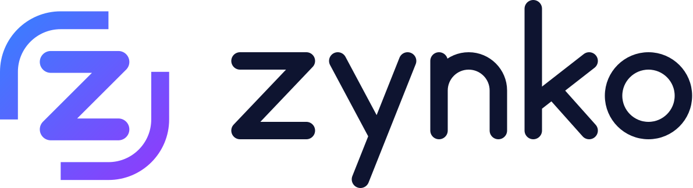

  <picture>
    <source media="(prefers-color-scheme: dark)" srcset=".github/assets/zynko-horizontal-dark.svg">
    
  </picture>

<b>Multimedia Home Center for Windows</b> 
Your Plex libraries, platform charts and smart lights in one place, designed for the TV and the remote control.

---

> **Status:** in development. There is no public release yet. Watch this repository (*Watch › Custom › Releases*) to be notified when the first version is available.

## What Zynko is

Zynko is a free app for Windows that turns the living-room PC into a media center:

- **Built-in player** for your Plex libraries, with 4K HDR, audio passthrough (Dolby Atmos, DTS-HD) and refresh-rate matching.
- **Home made for you:** sections such as *Continue watching*, *Recently added* or *Netflix Top 10*, with posters or landscape cards.
- **Profiles** for everyone at home, each with their own menu, watchlist and preferences.
- **Search** across your libraries, people and titles you don't have yet, with notifications when they arrive.
- **Philips Hue Sync:** lights that follow the picture.
- Designed for the **remote control**, with an on-screen keyboard and typing from your phone.

Coming later: local libraries, Jellyfin, Emby, Simkl and Home Assistant.

## Download

Installers will be published in [Releases](../../releases), digitally signed. Zynko checks for new versions itself and never installs one while you are watching something. Requirements (provisional): Windows 10/11 64-bit, a Plex Media Server account, and an HDR display for HDR playback.

## Help and feedback

- **Website:** [nexaproject-repository.github.io/zynko](https://nexaproject-repository.github.io/zynko/)
- **User guide:** [docs/user-guide](docs/user-guide/README.md)
- **Report a bug or suggest an idea:** [Issues](../../issues/new/choose)
- **Security problems:** see [SECURITY.md](SECURITY.md); please do not open a public issue.

## License

Zynko is **free to use** but **not open source**: see [LICENSE](LICENSE). It includes third-party components under their own licenses: see [THIRD_PARTY_NOTICES.md](THIRD_PARTY_NOTICES.md).

This product uses the TMDB API but is not endorsed or certified by TMDB. Plex is a trademark of Plex, Inc.; Zynko is not affiliated with Plex.
